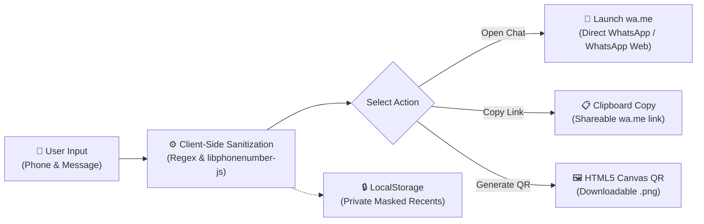

<div align="center">

# 💬 WA Direct

**Send WhatsApp Messages Instantly Without Saving Contacts — 100% Private & In-Browser**

[](https://astro.build)
[](https://react.dev)
[](https://tailwindcss.com)
[](#-privacy--security-first-design)
[](#-technical-seo--web-standards)
[](https://opensource.org/licenses/MIT)

[](https://kisharadilshan.gumroad.com/coffee)

[**🌐 Live Application**](https://wadirect.github.io) • [**☕ Support Developer**](https://kisharadilshan.gumroad.com/coffee) • [**📖 Documentation**](#-quick-start)

<br/>

<p align="center">
  
</p>

</div>

---

## 📑 Table of Contents

- [Overview](#-overview)
- [Key Features](#-key-features)
- [How It Works](#-how-it-works)
- [Privacy & Security First Design](#-privacy--security-first-design)
- [Tech Stack & Architecture](#-tech-stack--architecture)
- [Project Structure](#-project-structure)
- [Quick Start](#-quick-start)
- [Production Build & Deployment](#-production-build--deployment)
- [Technical SEO & Web Standards](#-technical-seo--web-standards)
- [Support the Developer](#-support-the-developer)
- [License](#-license)

---

## 📖 Overview

**WA Direct** (`wadirect.github.io`) is an ultra-fast, zero-server browser utility that allows users to initiate WhatsApp and WhatsApp Web chats directly with any valid phone number without cluttering their device address book.

Built on **Astro SSG** with an interactive **React Island**, WA Direct executes 100% of its functionality inside the client's browser. Phone numbers, custom notes, and interaction history never leave your device—there are **no databases, no intermediary APIs, no tracking cookies, and no backend servers**.

### 💡 Why WA Direct?
- **No Cluttered Contacts**: Keep your personal address book spotless by avoiding one-off numbers for delivery drivers, marketplace buyers, customer support, or Airbnb hosts.
- **Lightning Fast & Frictionless**: Clean, distraction-free interface with instant clipboard paste, timezone auto-country detection, and one-click chat launch.
- **Client-Side Security**: WhatsApp links (`wa.me`) and QR codes are calculated locally in your browser memory.

---

## ✨ Key Features

| Feature | Description |
| :--- | :--- |
| 🌍 **Smart Auto-Country Detection** | Uses `Intl.DateTimeFormat` and `countries-and-timezones` with `libphonenumber-js` to automatically detect your local calling code upon load. |
| 📋 **Smart Clipboard Paste** | Dedicated paste button automatically sanitizes formatted input—instantly removing spaces, dashes, parentheses, and brackets. |
| 💬 **Quick Snippets & Message Templates** | Pre-loaded with common message templates ("*Is this available?*", "*Here is my location.*", "*Following up.*") plus a modal to create and delete custom templates persisted in `localStorage`. |
| 🔗 **Click-to-Chat Link Creator** | Generates official `https://wa.me/{number}?text={encoded}` URLs with a 1-click clipboard copy button and dynamic visual confirmation. |
| 📱 **Instant QR Code Generator** | Generates an on-demand WhatsApp chat QR code rendered via HTML5 `<canvas>` (`qrcode.react`) with a 1-click **Download PNG** option for flyers, business cards, and desktop-to-mobile scanning. |
| 🕒 **Private Recent Numbers Tray** | Collapsible drawer storing up to 5 recent contacts in your browser's private `localStorage`. Numbers are automatically masked for screen privacy (e.g., `+1 555-***-1234`), with a one-click populate and master **Clear All** control. |
| 🛡️ **100% Zero-Server Privacy** | Zero tracking, zero analytics on numbers/messages, and zero data storage outside your private browser sandbox. |

---

## 🔄 How It Works



1. **Input or Paste**: Enter the recipient's phone number or click the clipboard button to paste formatted numbers.
2. **Optional Message**: Type your message or click any quick snippet chip to auto-populate.
3. **Launch or Share**:
   - Click **Open in WhatsApp** to open WhatsApp Web or the WhatsApp desktop/mobile app.
   - Click **Copy Link** to share the direct chat URL anywhere.
   - Click **QR Code** to generate a scannable and downloadable PNG QR code.

---

## 🔒 Privacy & Security First Design

WA Direct is engineered from the ground up to respect user confidentiality:

- **No Remote Endpoints**: Neither your recipient's phone number nor your message content is ever transmitted over network requests to any backend server.
- **Direct Official Integration**: WA Direct strictly relies on WhatsApp's official and encrypted Click-to-Chat protocol (`https://wa.me/<number>?text=<encoded_text>`).
- **Local Storage Isolation**: Custom message templates and the Recent Numbers tray are stored exclusively inside your browser's isolated `window.localStorage` partition and never synchronized to any cloud service.
- **Visual Privacy Masking**: Recent numbers are rendered with middle digits masked (`+1 555-***-1234`) to protect privacy in shared or public workspaces.

---

## 🛠️ Tech Stack & Architecture

| Layer | Technology | Purpose |
| :--- | :--- | :--- |
| **Framework** | [Astro v5.x / v7](https://astro.build) | Ultra-fast Static Site Generation (SSG) with zero runtime JS baseline |
| **Component UI** | [React 19](https://react.dev) | Interactive form state, modals, clipboard handling, and client islands |
| **Styling** | [Tailwind CSS v4](https://tailwindcss.com) | Modern, responsive, clean-light design system via `@tailwindcss/vite` |
| **Icons** | [Lucide React](https://lucide.dev) | Crisp, lightweight, accessible SVG iconography |
| **Phone Sanitization** | [libphonenumber-js](https://gitlab.com/catamphetamine/libphonenumber-js) | Standard international phone number validation and calling code resolution |
| **Timezone Detection** | [countries-and-timezones](https://github.com/manuelbieh/countries-and-timezones) | Client-side timezone to ISO country code mapping |
| **QR Code Engine** | [qrcode.react](https://github.com/zpao/qrcode.react) | Canvas-based high-density QR code rendering with direct PNG data export |
| **Deployment** | [GitHub Pages](https://pages.github.com) | Automated deployment through GitHub Actions workflow |

---

## 📁 Project Structure

```text
wadirect.github.io/
├── .github/
│   └── workflows/
│       └── deploy.yml          # Automated GitHub Actions deployment pipeline
├── public/
│   ├── favicon.svg             # Minimalist WA Direct brand SVG favicon
│   └── robots.txt              # Search engine crawler instructions
├── src/
│   ├── components/
│   │   └── WaDirectForm.tsx    # Interactive React Island (Form, QR, Recents, Snippets)
│   ├── layouts/
│   │   └── Layout.astro        # Base HTML layout, SEO meta tags, JSON-LD Schema
│   ├── pages/
│   │   └── index.astro         # Main landing page & instructional sections
│   └── styles/
│       └── global.css          # Tailwind CSS root imports & global typography
├── astro.config.mjs            # Astro configuration, plugins & sitemap setup
├── package.json                # Project dependencies and script definitions
└── tsconfig.json               # TypeScript compiler configuration
```

---

## 🚀 Quick Start

### Prerequisites
- **Node.js**: `v22.12.0` or higher (required by Astro v5+)
- **Package Manager**: `npm` (or `pnpm` / `yarn`)

### 1. Clone the Repository
```bash
git clone https://github.com/wadirect/wadirect.github.io.git
cd wadirect.github.io
```

### 2. Install Dependencies
```bash
npm install
```

### 3. Start Local Development Server
```bash
npm run dev
```
Open your browser at `http://localhost:4321` to preview the live application.

---

## 📦 Production Build & Deployment

### Build the Static Site
```bash
npm run build
```
This generates an optimized static distribution in the `./dist/` directory along with an automatically generated `sitemap-index.xml`.

### Preview Production Build
```bash
npm run preview
```

### Automated GitHub Pages Deployment
The repository includes a ready-to-use GitHub Actions workflow located at `.github/workflows/deploy.yml`:
1. Push your changes to the `main` branch.
2. In your GitHub repository settings, navigate to **Settings > Pages**.
3. Under **Build and deployment > Source**, ensure **GitHub Actions** is selected.
4. Your site will automatically build and publish to `https://wadirect.github.io`.

---

## 📈 Technical SEO & Web Standards

- **Open Graph & Twitter Cards**: Pre-configured with rich media sharing tags and social banners.
- **Structured Data (JSON-LD)**: Injects inline `SoftwareApplication` schema recognized by search engines:
  ```json
  {
    "@context": "https://schema.org",
    "@type": "SoftwareApplication",
    "name": "WA Direct Message Tool",
    "applicationCategory": "CommunicationApplication",
    "operatingSystem": "Any (Web Browser)",
    "offers": {
      "@type": "Offer",
      "price": "0",
      "priceCurrency": "USD"
    }
  }
  ```
- **Sitemap & Robots**: Powered by `@astrojs/sitemap` to ensure full indexing and search crawler accessibility.
- **Full Accessibility (a11y)**: Explicit `aria-label` attributes on icon-only buttons, proper `<label>`-input associations, and `aria-hidden="true"` applied to decorative SVGs.

---

## ☕ Support the Developer

If you find this free, privacy-first tool helpful, consider supporting its continued maintenance and development:

<div align="center">

[](https://kisharadilshan.gumroad.com/coffee)

[**👉 Support on Gumroad**](https://kisharadilshan.gumroad.com/coffee)

</div>

---

## 📄 License

This project is open-source and distributed under the [MIT License](https://opensource.org/licenses/MIT).

---

<div align="center">
  <sub>Built with ❤️ for privacy and simplicity. WA Direct is an independent tool and is not affiliated with WhatsApp Inc. or Meta Platforms, Inc.</sub>
</div>
